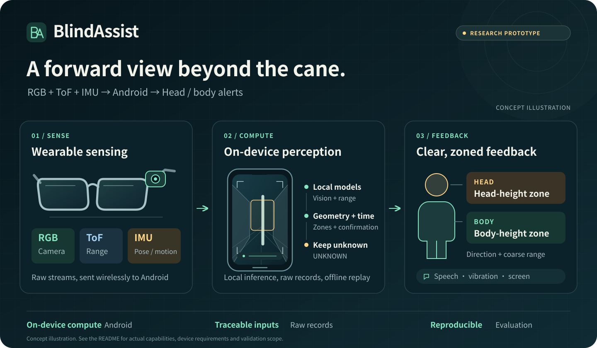
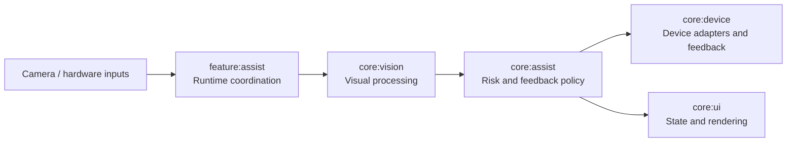

# BlindAssist

**English** | [简体中文](README.zh-CN.md)

**RGB, ToF and IMU inputs from a wearable feed local Android perception, producing obstacle cues for head and body zones.**

[Explore the demo](docs/HARDWARE_OBSTACLE_DEMO.md) · [Record data](docs/PHONE_DATA_CAPTURE.md) · [Build it](#quick-start) · [Contribute](CONTRIBUTING.md) · [Developer quick start](docs/QUICKSTART_EN.md)



## What you can do

The current source version is **10.20.1 / versionCode 64** (2026-10-14). The [changelog](CHANGELOG.md) distinguishes demo builds, trial builds and the validation completed for each version. See the [hardware demo guide](docs/HARDWARE_OBSTACLE_DEMO.md) for operation.

| Entry point | What it provides |
| --- | --- |
| **Home → Fusion demo** | An undistorted viewfinder, HEAD/BODY zones, ToF/RGB sources and 2-of-3-frame confirmation; speech/vibration on confirmed alerts |
| **Home → Data capture** | RGB preview, an 8×8 range grid and IMU; raw JPEG, full 8×8×16 CNH, pose and timestamps, with background ZIP export |
| **Home → Start assist** | Basic ToF alerts with the current H3 firmware; explicit start/stop and language, speech and vibration preferences |
| **Research scripts → Offline replay** | Reproduction by source and recording, preserving input contracts, frozen versions and negative results |

The 10.20.1 `demo` build supports system precompilation. On an S24 Ultra, ToF inference dropped from approximately **300–400 → 42 ms/frame**. This measures model execution on that device. [Engineering record and measurement scope](CHANGELOG.md#10201--2026-10-14演示包)

**Research scope:** BlindAssist is a research prototype for cane-complementary, class-agnostic forward obstacle awareness. Evidence includes device capture-integrity checks and frozen offline evaluations on new wearable recordings. Current fusion demo rules remain development candidates; stopping the demo allows a return to frozen v2. Complete online fusion and the alert experience still need validation. Calibration, narrow-corridor false alerts and independent device clocks remain limitations. Synthetic, replay and device evidence are recorded separately; `UNKNOWN` does not mean clear, and these results do not establish traversability or navigation safety. [Research and evaluation rules](docs/formal/RESEARCH_GOVERNANCE.md)

<details>
<summary>View real interface snapshots · 2026-08-13 / v10.9.0</summary>

These S24 Ultra screenshots show the existing Chinese interface and interaction style. The fusion viewfinder was subsequently updated in 10.20.1.

<table>
  <tr>
    <td align="center"></td>
    <td align="center"></td>
    <td align="center"></td>
  </tr>
  <tr>
    <td align="center">Feature entry points</td>
    <td align="center">Local assistance profile</td>
    <td align="center">Personalized feedback</td>
  </tr>
</table>

</details>

## Quick start

Minimum Android version: **8.0 / API 26**. The maintained Windows development path uses **PowerShell 7, JDK 17 and Android SDK Platform 37**. The [developer quick start](docs/QUICKSTART_EN.md) describes the Linux path and its validation scope.

```powershell
git clone https://github.com/violetljj/blind-assist.git
cd blind-assist
pwsh -NoProfile -File scripts/run_android_gradle.ps1 -PreflightOnly
pwsh -NoProfile -File scripts/run_android_gradle.ps1 :app:assembleDebug
```

You can build and inspect the home screen without hardware. With Atom/H3 connected, follow the [phone capture guide](docs/PHONE_DATA_CAPTURE.md) to record and export. H3 allows only one TCP consumer at a time; stop any desktop preview or other capture session first.

Fusion requires matching experimental models, the applicable local runtime and compatible hardware. Follow the [demo guide](docs/HARDWARE_OBSTACLE_DEMO.md) for deployment. For live demonstrations, use:

```powershell
pwsh -NoProfile -File scripts/run_android_gradle.ps1 :app:assembleDemo
```

Set up research tools as needed; an Android build does not install them:

```powershell
Copy-Item config/local.example.toml config/local.toml
pwsh -NoProfile -File tools/ba.ps1 setup research-dtr-r0
pwsh -NoProfile -File tools/ba.ps1 doctor research-dtr-r0
```

Keep local tools, data, models and evidence payloads under ignored `artifacts.local/`. See [local artifact configuration](docs/LOCAL_ARTIFACTS.md).

## Architecture and research



`app` owns entry points and assets; `apps/` contains isolated research and benchmark applications. See the [code map](docs/CODE_MAP.md) for interfaces and ownership.

| To learn about | Start here |
| --- | --- |
| System status, measurements and main gaps | [One-page project status](docs/PROJECT_STATE.md) |
| Current research choices and next steps | [Research decisions](docs/CURRENT_DECISION.md) |
| Forward perception and retained DTR research | [Forward perception status](research/active/dtr-r0/CURRENT.md) |
| Sensor integration, calibration and device evidence | [Hardware research status](research/active/hardware-bringup/CURRENT.md) |
| Paused L10 results | [Retained L10 evidence](research/active/l10-r0/CURRENT.md) |
| Documentation and historical reproduction | [Documentation map](docs/README.md) · [History index](docs/history-index.md) |

Detailed hardware and research notes are currently mostly in Chinese.

## Contribute

Contributions are welcome in English or Chinese, especially Android accessibility, lifecycle and capture reliability, reproducible tooling and documentation.

- Start with a [`good first issue`](https://github.com/violetljj/blind-assist/issues?q=is%3Aissue%20state%3Aopen%20label%3A%22good%20first%20issue%22) and read the [contribution guide](CONTRIBUTING.md).
- Report reproducible problems in [Issues](https://github.com/violetljj/blind-assist/issues); share early ideas and questions in [Discussions](https://github.com/violetljj/blind-assist/discussions).
- Discuss substantial changes to models, permissions, feedback policy or research contracts first. Include verification commands, remaining gaps and default-app impact in each contribution.
- Use the [security reporting instructions](SECURITY.md) for security and privacy concerns; see the [threat model](docs/THREAT_MODEL.md) for system boundaries. Keep raw camera footage, private information, credentials and restricted data out of the public repository.

Code is licensed under [AGPL-3.0-only](LICENSE). See the [model card](docs/MODEL_CARD.md) and [third-party notices](THIRD_PARTY_NOTICES.md) for model and asset provenance and licenses, and [governance](GOVERNANCE.md) and [maintainer automation](docs/operations/CODEX_MAINTAINER_AUTOMATION.md) for maintenance rules.
