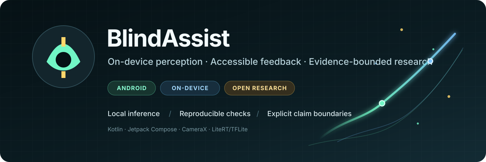
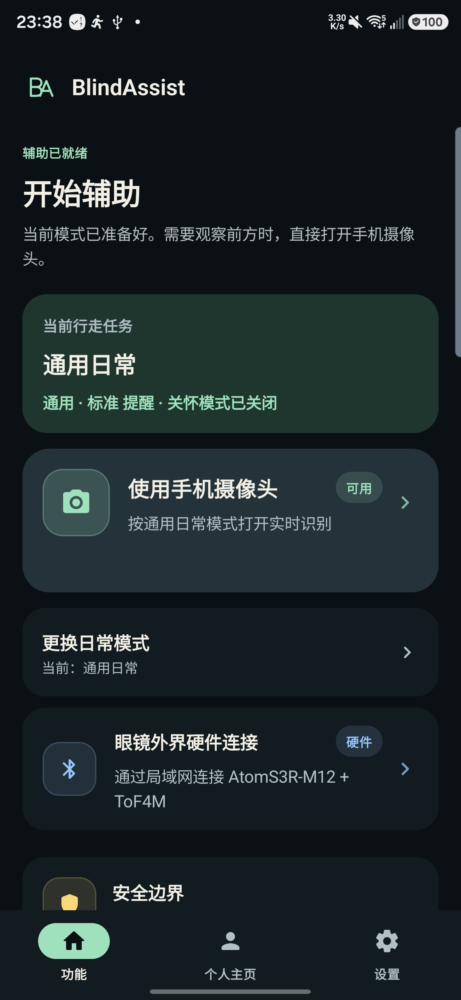
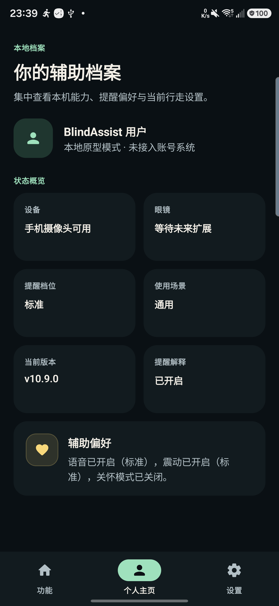
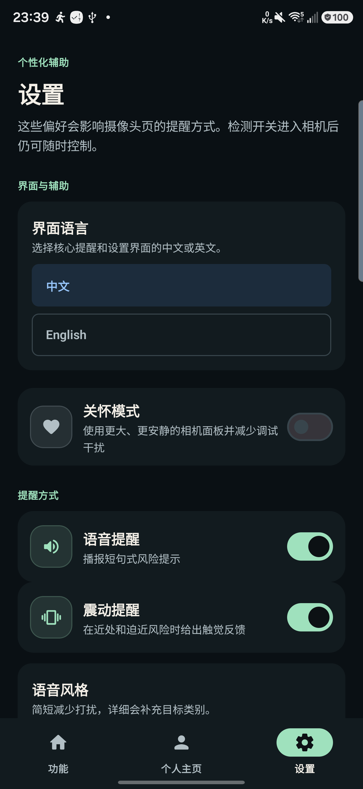
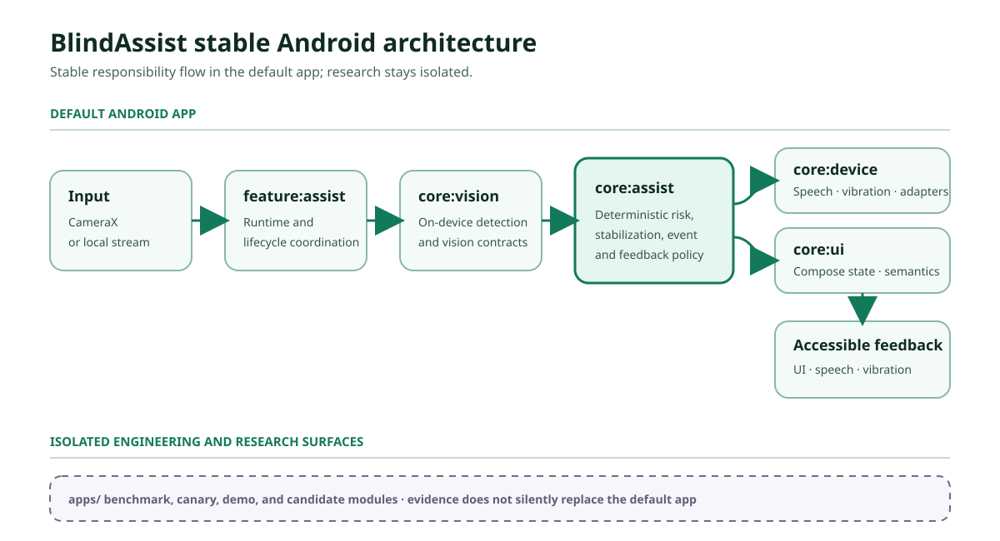

# BlindAssist · 盲杖互补前视感知

**用 Android、RGB 相机、ToF 和 IMU，探索盲杖之外的前方障碍提醒。**
关注墙体、大型遮挡、身体／头部凸出物、悬空障碍与不同高度的细杆，在有限算力下提供方向和粗距离线索。类别无关前视感知是当前研究目标，具体能力与验证范围见下表；移动选择由佩戴者作出。

An Android research prototype for **cane-complementary, class-agnostic forward obstacle awareness**, with on-device perception and inspectable evidence.

[快速开始](#快速开始) · [硬件演示](docs/HARDWARE_OBSTACLE_DEMO.md) · [手机采集](docs/PHONE_DATA_CAPTURE.md) · [English quick start](docs/QUICKSTART_EN.md) · [参与贡献](CONTRIBUTING.md)

## 现在可以做什么

当前源码为 **10.20.1 / versionCode 64**（2026-10-14）。[更新记录](CHANGELOG.md)区分演示包、试用包与各轮实机验证，具体操作见[硬件演示指南](docs/HARDWARE_OBSTACLE_DEMO.md)。

| 入口 | 已实现的能力 | 当前验证范围 |
| --- | --- | --- |
| **数据采集** | 同屏预览 Atom RGB、8×8 ToF 网格与 BMI270 IMU；保存原始 JPEG、完整 8×8×16 CNH、姿态和时间戳；后台导出 ZIP | 已有真机三路录制、断线恢复和文件完整性检查；各设备时钟独立 |
| **开始辅助** | 显式开始／结束；当前 H3 固件提供基础 ToF 提醒，支持语言、语音与震动偏好 | 基础辅助与融合演示分别保留；旧时序协议的 A+LOCAL 为实验模式 |
| **融合演示** | 首页直达；去畸变取景器、HEAD／BODY 状态、ToF／RGB 来源、2/3 帧确认及语音／震动 | 演示规则采用开发候选，可停止后切回冻结 v2；完整在线融合与提醒体验仍需验证 |
| **研究与回放** | 冻结脚本、输入合同、来源记录、逐段结果和负结果 | 已有头戴新录制的冻结离线评价；小样本、标定失败及窄走廊误报仍限制结论 |

**最近的工程进展：** 10.20.1 新增不可调试的 `demo` 构建；S24 Ultra 上预编译后，ToF 推理由约 300–400 ms/帧降至约 42 ms/帧。这是特定设备的模型执行时间，完整响应时间与持续使用表现仍待测量。[版本与测量范围](CHANGELOG.md#10201--2026-10-14演示包)

> BlindAssist 是展示与研究原型。`UNKNOWN` 不代表无障碍；它尚不构成可通行判断、通用实景准确率或导航安全证明。

## 界面预览

<table>
  <tr>
    <td align="center"></td>
    <td align="center"></td>
    <td align="center"></td>
  </tr>
  <tr>
    <td align="center">功能入口</td>
    <td align="center">本地辅助档案</td>
    <td align="center">个性化反馈</td>
  </tr>
</table>

以上是 **2026-08-13、v10.9.0、S24 Ultra 的真实界面存档**，用于展示交互风格；当前融合取景器已在 10.20.1 更新，具体行为以使用指南与更新记录为准。

## 快速开始

Android 最低版本为 **8.0 / API 26**。维护的 Windows 开发路径使用 **PowerShell 7、JDK 17、Android SDK Platform 35**；Linux 路径及其验证范围见 [English quick start](docs/QUICKSTART_EN.md)。

```powershell
git clone https://github.com/violetljj/blind-assist.git
cd blind-assist
pwsh -NoProfile -File scripts/run_android_gradle.ps1 -PreflightOnly
pwsh -NoProfile -File scripts/run_android_gradle.ps1 :app:assembleDebug
```

无硬件也可以构建并查看首页。连接 Atom／H3 后，可按[手机采集说明](docs/PHONE_DATA_CAPTURE.md)录制与导出；H3 同时只允许一个 TCP 消费者，先结束电脑预览或其他采集会话。

融合演示另需匹配的实验模型、可选本地运行时与兼容硬件，按[演示指南](docs/HARDWARE_OBSTACLE_DEMO.md)部署。面向实际演示使用：

```powershell
pwsh -NoProfile -File scripts/run_android_gradle.ps1 :app:assembleDemo
```

研究环境按需配置，不随 Android 构建自动安装：

```powershell
Copy-Item config/local.example.toml config/local.toml
pwsh -NoProfile -File tools/ba.ps1 setup research-dtr-r0
pwsh -NoProfile -File tools/ba.ps1 doctor research-dtr-r0
```

本地工具、数据、模型和证据载荷使用忽略的 `artifacts.local/`，配置方法见[本地产物说明](docs/LOCAL_ARTIFACTS.md)。

## 架构与研究入口



`app` 管理入口与资产，`feature:assist` 协调运行生命周期；`core:vision` 负责视觉，`core:assist` 负责风险与反馈策略，`core:device` 和 `core:ui` 负责设备适配及界面。研究、基准与候选应用保留在独立模块中。[代码地图](docs/CODE_MAP.md)

| 想了解什么 | 从这里开始 |
| --- | --- |
| 系统现状、指标与主要缺口 | [中文一页状态](docs/PROJECT_STATE.md) |
| 当前研究选择与下一步 | [总研究决定](docs/CURRENT_DECISION.md) |
| 前视感知与保留的 DTR 研究 | [前视感知当前状态](research/active/dtr-r0/CURRENT.md) |
| 传感器接入、标定与实机证据 | [硬件研究当前状态](research/active/hardware-bringup/CURRENT.md) |
| 已暂停的 L10 结果 | [L10 保留证据](research/active/l10-r0/CURRENT.md) |
| 完整文档与历史复现 | [文档地图](docs/README.md) · [历史索引](docs/history-index.md) |

合成、回放、Development、设备与自然场景证据分别记录。新增研究结果不自动替换默认 App；新冻结数据也不用于事后调阈值。受保护的最终评价按[正式研究规则](docs/formal/RESEARCH_GOVERNANCE.md)执行。

## 一起改进

欢迎中文或英文贡献，尤其是 Android 无障碍、生命周期与采集可靠性、可复现工具和文档。

- 从 [`good first issue`](https://github.com/violetljj/blind-assist/issues?q=is%3Aissue%20state%3Aopen%20label%3A%22good%20first%20issue%22) 开始，先阅读[贡献指南](CONTRIBUTING.md)。
- 可复现问题提交到 [Issues](https://github.com/violetljj/blind-assist/issues)，早期想法与使用交流放在 [Discussions](https://github.com/violetljj/blind-assist/discussions)。
- 模型、权限、反馈策略或研究合同的大幅变更先讨论；每次贡献说明验证命令、剩余缺口及默认 App 影响。
- 安全与隐私问题按[安全报告说明](SECURITY.md)提交，系统边界见[威胁模型](docs/THREAT_MODEL.md)；相机原始素材、私人信息、密钥及受限数据不进入公开仓库。

代码采用 [AGPL-3.0-only](LICENSE)。模型与第三方资产的身份、来源和许可证见[模型卡](docs/MODEL_CARD.md)及[第三方声明](THIRD_PARTY_NOTICES.md)；维护规则见[公开治理](GOVERNANCE.md)与[维护自动化](docs/operations/CODEX_MAINTAINER_AUTOMATION.md)。
