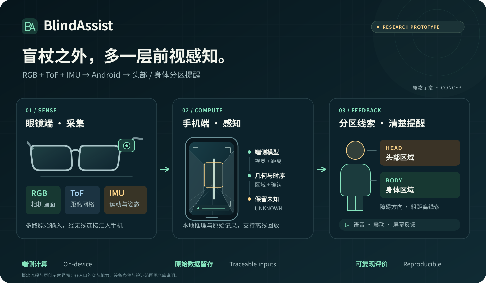
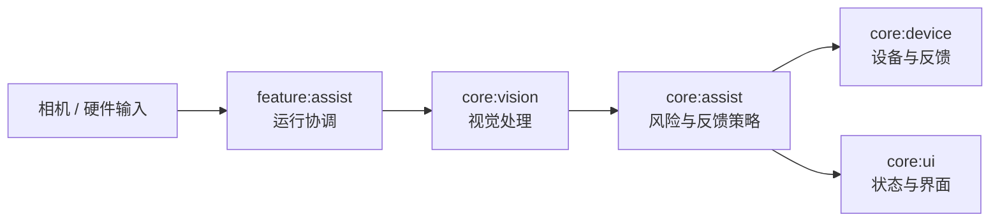

# BlindAssist

[English](README.md) | **简体中文**

**眼镜采集 RGB、ToF 与 IMU，手机在本地感知前方障碍，给出头部／身体区域的提醒。**

[体验演示](docs/HARDWARE_OBSTACLE_DEMO.md) · [录制数据](docs/PHONE_DATA_CAPTURE.md) · [开始构建](#快速开始) · [参与贡献](CONTRIBUTING.md) · [English quick start](docs/QUICKSTART_EN.md)



## 现在可以做什么

当前源码为 **10.20.1 / versionCode 64**（2026-10-14）。[更新记录](CHANGELOG.md)区分演示包、试用包与各轮实机验证，具体操作见[硬件演示指南](docs/HARDWARE_OBSTACLE_DEMO.md)。

| 从哪里进入 | 可以看到什么 |
| --- | --- |
| **首页 → 融合演示** | 去畸变取景器、HEAD／BODY 分区、ToF／RGB 来源与 2/3 帧确认；确认报警时提供语音／震动 |
| **首页 → 数据采集** | RGB 画面、8×8 距离网格与 IMU；保存原始 JPEG、完整 8×8×16 CNH、姿态及时间戳，后台导出 ZIP |
| **首页 → 开始辅助** | 当前 H3 固件的基础 ToF 提醒；显式开始／结束，支持语言、语音与震动偏好 |
| **研究脚本 → 离线回放** | 按来源与逐段结果复现，保留输入合同、冻结版本和负结果 |

10.20.1 的 `demo` 构建支持系统预编译，S24 Ultra 上 ToF 推理由约 **300–400 → 42 ms/帧**；这是该设备的模型执行时间。[工程记录与测量范围](CHANGELOG.md#10201--2026-10-14演示包)

**研究定位与验证范围：** BlindAssist 是盲杖互补的类别无关前视感知研究原型（cane-complementary）。已有真机采集完整性检查及头戴新录制的冻结离线评价；当前融合演示规则仍是开发候选，可停止后切回冻结 v2，完整在线融合与提醒体验待验证。标定、窄走廊误报和独立设备时钟仍是限制；合成、回放和设备证据分别记录，`UNKNOWN` 不代表无障碍，尚不能据此判断可通行或导航安全。[研究与评价规则](docs/formal/RESEARCH_GOVERNANCE.md)

<details>
<summary>查看真实界面存档 · 2026-08-13 / v10.9.0</summary>

以下截图来自 S24 Ultra，展示已有主界面的交互风格；当前融合取景器已在 10.20.1 更新。

<table>
  <tr>
    <td align="center"></td>
    <td align="center"></td>
    <td align="center"></td>
  </tr>
  <tr>
    <td align="center">功能入口</td>
    <td align="center">本地辅助档案</td>
    <td align="center">个性化反馈</td>
  </tr>
</table>

</details>

## 快速开始

Android 最低版本为 **8.0 / API 26**。维护的 Windows 开发路径使用 **PowerShell 7、JDK 17、Android SDK Platform 37**；Linux 路径及其验证范围见 [English quick start](docs/QUICKSTART_EN.md)。

```powershell
git clone https://github.com/violetljj/blind-assist.git
cd blind-assist
pwsh -NoProfile -File scripts/run_android_gradle.ps1 -PreflightOnly
pwsh -NoProfile -File scripts/run_android_gradle.ps1 :app:assembleDebug
```

无硬件也可以构建并查看首页。连接 Atom／H3 后，可按[手机采集说明](docs/PHONE_DATA_CAPTURE.md)录制与导出；H3 同时只允许一个 TCP 消费者，先结束电脑预览或其他采集会话。

融合演示另需匹配的实验模型、可选本地运行时与兼容硬件，按[演示指南](docs/HARDWARE_OBSTACLE_DEMO.md)部署。面向实际演示使用：

```powershell
pwsh -NoProfile -File scripts/run_android_gradle.ps1 :app:assembleDemo
```

研究环境按需配置，不随 Android 构建自动安装：

```powershell
Copy-Item config/local.example.toml config/local.toml
pwsh -NoProfile -File tools/ba.ps1 setup research-dtr-r0
pwsh -NoProfile -File tools/ba.ps1 doctor research-dtr-r0
```

本地工具、数据、模型和证据载荷使用忽略的 `artifacts.local/`，配置方法见[本地产物说明](docs/LOCAL_ARTIFACTS.md)。

## 架构与研究入口



`app` 管理入口与资产，`apps/` 保留独立研究与基准应用。具体接口和所有权见[代码地图](docs/CODE_MAP.md)。

| 想了解什么 | 从这里开始 |
| --- | --- |
| 系统现状、指标与主要缺口 | [中文一页状态](docs/PROJECT_STATE.md) |
| 当前研究选择与下一步 | [总研究决定](docs/CURRENT_DECISION.md) |
| 前视感知与保留的 DTR 研究 | [前视感知当前状态](research/active/dtr-r0/CURRENT.md) |
| 传感器接入、标定与实机证据 | [硬件研究当前状态](research/active/hardware-bringup/CURRENT.md) |
| 已暂停的 L10 结果 | [L10 保留证据](research/active/l10-r0/CURRENT.md) |
| 完整文档与历史复现 | [文档地图](docs/README.md) · [历史索引](docs/history-index.md) |

## 一起改进

欢迎中文或英文贡献，尤其是 Android 无障碍、生命周期与采集可靠性、可复现工具和文档。

- 从 [`good first issue`](https://github.com/violetljj/blind-assist/issues?q=is%3Aissue%20state%3Aopen%20label%3A%22good%20first%20issue%22) 开始，先阅读[贡献指南](CONTRIBUTING.md)。
- 可复现问题提交到 [Issues](https://github.com/violetljj/blind-assist/issues)，早期想法与使用交流放在 [Discussions](https://github.com/violetljj/blind-assist/discussions)。
- 模型、权限、反馈策略或研究合同的大幅变更先讨论；每次贡献说明验证命令、剩余缺口及默认 App 影响。
- 安全与隐私问题按[安全报告说明](SECURITY.md)提交，系统边界见[威胁模型](docs/THREAT_MODEL.md)；相机原始素材、私人信息、密钥及受限数据不进入公开仓库。

代码采用 [AGPL-3.0-only](LICENSE)。模型与第三方资产的身份、来源和许可证见[模型卡](docs/MODEL_CARD.md)及[第三方声明](THIRD_PARTY_NOTICES.md)；维护规则见[公开治理](GOVERNANCE.md)与[维护自动化](docs/operations/CODEX_MAINTAINER_AUTOMATION.md)。
