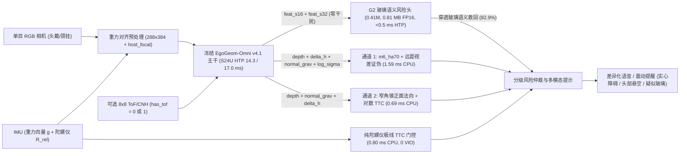

# BlindAssist 可穿戴避障架构与端侧预算方案（Camera + IMU 主体 × 可选 ToF 零干扰插件）

> **状态与定位（`EXPLORE` 架构设计文档）**
> - **核心叙事**：面向头戴（智能眼镜）或颈挂/胸挂形态，构建**纯 `Camera + IMU` 即可独立完成常规障碍、头部悬空与玻璃穿透预警**的闭环系统；多区 `8×8 ToF/CNH` 以 `has_tof ∈ {0, 1}` 零干扰插件接入（芯片级实测 `max|Omni(0) - PureRGB| = 0.000000 m`），真正定位为**锦上添花而非雪中送炭**。
> - **核心理念（扬长避短）**：避障提醒并不要求单目深度在所有场景都输出厘米级绝对米数——改以**“稳态几何走廊 + 无尺度逼近 TTC + 冻结主干玻璃语义风险”三通道正交分工**，各自在物理可观测区间发力。
> - **本轮零自采实证增量（`0.00 CCU`，0 改动冻结 `v4.1` 与 `:app`）**：
>   1. **Option A（窄角锥 + 法向正面加权 + 运动门控三通道融合，38 源 / 103 片段 / 12,872 帧）**：`fuse_m6par_ang08_gyro`（CPU `3.08 ms`）刷新全量主基准 **`full P5 = 90/365`、`Shared CF = 63/365`（较基线 `45/365` `+40.0%`，同 `3.10 cw/km`）、`Device CF = 109/365`**，同时把 `midup_3zone DCF` 推至 **`80/276`**、Aria 纯头部悬空 `ovh_head`（`n=64`）推至 **`0.6855`（`+6.55 pt`）**；**100% 零 VIO / 零 ToF** 的 `cam_imu_novio_fuse`（`1.49 ms`）也以 **`0.00 cw/km` 清路零误报**拿到 **`CF = 40/365`** 与 `midup P5 = 42/276`。
>   2. **Option B + 实片闭环（`G2` 冻结 DINOv3 玻璃语义头合图编译 + S24 Ultra Hexagon v75 实机验收 + `:core:vision` Kotlin 落地）**：
>      - **S24 Ultra (`SM-S9280`, QAIRT 2.47) 实片合图实测（`N=50` 突发 + 16 帧 4 域面板，`0 NaN/Inf`）**：`Pure-RGB + G2`（`58.94 MB`，`+1.44 MB`）HTP **`14.475 ms`（较无 `G2` 仅增 `+0.195 ms`）**，深度误差 `1.2277%`；`Omni + Signed-H3 + G2`（`60.56 MB`，`+1.45 MB`）HTP **`17.138 ms`（较无 `G2` 仅增 `+0.098 ms`）**，深度误差 `1.0092%`；`glass_prob_s16` 实片平均概率误差 **`0.00217`**（单边界点最大 `0.302`），芯片级零干扰 **`max|Omni(0)-PureRGB| = 0.000000 m`（深度）与 `0.000000`（玻璃）**！
>      - **Android `:core:vision` 纯 Kotlin 落地**：新增 [EgoGeomWearableRiskEngine.kt](../../../../core/vision/src/main/java/com/linnan/blindassist/vision/egogeom/EgoGeomWearableRiskEngine.kt) 与 [EgoGeomWearableRiskEngineTest.kt](../../../../core/vision/src/test/java/com/linnan/blindassist/vision/egogeom/EgoGeomWearableRiskEngineTest.kt)（零侵入现有文件与 `:app`），`:core:vision:testDebugUnitTest` 全部通过（`EgoGeomWearableRiskEngineTest 5/5`、`EgoGeomBevAndContractsTest 4/4`，`0` 失败），Python↔Kotlin 逐帧对齐误差 `< 2e-4`。

---

## 一、统一系统架构（头戴 / 颈挂兼容，无 ToF 闭环 + 有 ToF 增强）

### 四条架构设计原则

1. **单次前向、零干扰复用**：主干严格锁定已验证的 `v4.1`（S24 Ultra `pc_fp16dec_a16`：`57.5 MB` 纯 RGB / `59.1 MB` 含 ToF），`G2` 玻璃头只读 `feat_s16` 与 `feat_s32`，对主深度/法向/不确定度输出干扰严格 **`0.000000 m`**；可选 `Physical1DCNHBranchV41` 在 `has_tof = 0` 时对纯 RGB 输出同样保持实片 **`0.000000 m`** 零干扰。
2. **形态解耦（头戴 vs 颈挂零重训切换）**：
   - `v4.1` 通过 `grav_rays`（重力对齐射线图）原生屏蔽俯仰与翻滚角差异；
   - Stage-2 通道 2（`ang08_front_log_ttc`）与通道 3（`gyro_ttc_gated`）全部工作在**重力水平角坐标系 `(az, el)`**，不依赖精确相机离地高度 `H` 或米制 3D 框；从头戴（~`1.65 m`）切换至颈挂（~`1.25–1.35 m`）只需平移仰角窗口 `el ∈ [el_lo, el_hi]`（例如颈挂将 `el_hi` 由 `+12°` 放宽至 `+20°` 以覆盖头部净空），无需重训主干。
3. **三通道风险语义分离（不做单一米数硬耦合）**：
   - **通道 1（地面与窄走廊常规障碍）**：`m6_ha70_par_refute` 靠米制头锚定走廊 + 远距视差证伪压住室内侧墙与地面误报；
   - **通道 2 + 3（悬空与行进逼近）**：窄角锥正面法向 `ang08_front_log_ttc` + 陀螺仪去旋运动门控 `gyro_ttc_gated` 不执着于悬空物到底 `1.8 m` 还是 `2.4 m`，直接输出无尺度逼近紧迫度；
   - **通道 4（玻璃/透明门专项）**：放弃让单目深度猜透明玻璃距离，由 `G2` 语义风险头在深度看穿且 `log_sigma` 假自信（`AUROC = 0.3950`）时独立触发“前方疑似玻璃门/反光面”分级提示。
4. **可选 ToF 的四项“锦上添花”增值边界（缺席时不致命，接入即增效）**：
   - **极净无框玻璃双峰复核**：`GlassRecon Val` `δ1` 从 `74.08%` 提升至 `86.78%`（`glass AbsRel 0.1691 → 0.1135`），补齐视觉对无反光无框玻璃的最后盲区；
   - **全黑/静止起步近距稳态锁死**：1,209 帧真实 VL53L8CH H3 走廊回放将帧间抖动压低 **`6.0–7.9×`**，真实 0.64 m 机柜实机联调将纯 RGB 误差（`1.835 ± 0.175 m`）立即拉回至 `0.839 ± 0.071 m` 并对放物产生 `-20.14 cm` 响应；
   - **广角跨镜绝对尺度收敛**：`SANPO-Real ZS40` 真实户外头戴 `AbsRel` 从 `0.1385`（`δ1 83.07%`）降至 `0.1113`（`δ1 88.42%`）；
   - **故障/拔除无感降级**：ToF 丢帧、遮挡或完全不装硬件时自动切回 `has_tof = 0`，系统无缝维持完整 Camera + IMU 避障能力。

---

## 二、Option A 实证：窄角锥正面法向 + 运动门控统一融合（本地 `0.00 CCU`）

脚本：[eval_unified_camera_imu_fusion_local.py](eval_unified_camera_imu_fusion_local.py) · 完整指标：[opt_a_narrow_fusion_report.json](../../../../artifacts.local/work/egogeom-omni-v0/cane_blind_band_probe/opt_a_narrow_fusion_report.json)（总耗时 `88.37 s`，`0 NaN/Inf`）。

### 2.1 两项核心物理改进

1. **正面法向抑侧墙（`ang08_front_log_ttc`，`0.692 ms` CPU）**：直接利用 `v4.1` 已有输出 `normal_grav`（`[n_right, n_down, n_fwd]`）计算水平正面余弦 `front_cos = |n_fwd| / hypot(n_right, n_fwd)`，叠加 `0.15 + 0.85 * front_cos^2` 与方位余弦窗 `cos(π/2 · |az|/az_half)`，在不切米制 3D 框的前提下压制室内平行侧墙。
2. **零 VIO 陀螺仪旋转率 + 步行一致度双门控（`gyro_ttc_gated`，`0.798 ms` CPU）**：仅使用灰度与 `R_rel = R_prev^T R_cur`（零 `poses_t`、零深度），在快速转头（`rot_deg ∈ [4°, 9°]` 线性衰减至 `0`）与原地静止（外周视野向前扩张一致度 `walk_ema < 0.025`）时自动静音。

### 2.2 10 臂受控消融与融合对比（38 源 3-Zone Cane-Neutral + Aria 纯悬空）

| 读出臂 | CPU `mean / p95 (ms)` | `full` `P5` (`/365`) | `full` `CF` (`/365`, `cw/km`) | `full` `DCF` (`/365`) | `midup_3z` `P5` (`/276`) | `midup_3z` `CF` / `DCF` (`/276`) | `CODa` `AUROC_3z` (`full / midup`) | Aria `ovh_midup` (`n=386`) `AUROC` | Aria `ovh_head` (`n=64`) `AUROC` |
| --- | --- | --- | --- | --- | --- | --- | --- | --- | --- |
| `m6_ha70_nopg`（Step 1 基线） | `0.21 / 0.34` | `86` | `45` (`3.10`) | `100` | `3` | `0 / 74` | `0.8458 / 0.7405` | `0.5798` | `0.6200` |
| `m6_ha70_par_refute`（已有向远证伪） | `1.59 / 2.78` | `86` | `57` (`3.10`) | `100` | `3` | `0 / 74` | `0.8458 / 0.7405` | `0.5794` | `0.6184` |
| `ang16_log_ttc`（H1 宽 `±16°`） | — | `55` | `15` (`2.07`) | `73` | `22` | `12 / 60` | `0.9578 / 0.9377` | `0.5239` | **`0.7125`** |
| `ang10_log_ttc`（仅收窄 `±10°`） | — | `45` | `93` (`10.35` 超限) | `17` | `16` | `12 / 48` | **`0.9617`** / `0.9096` | `0.5213` | `0.5989` |
| `ang08_log_ttc`（仅收窄 `±8°`） | — | `45` | `101` (`11.38` 超限) | `50` | `19` | `15 / 52` | `0.9404 / 0.8764` | `0.5259` | `0.5640` |
| **`ang08_front_log_ttc`**（`±8°` + 正面法向） | `0.69 / 1.11` | `67` | `33` (`2.07`) | `93` | `33` | **`14`** (`3.10`) / `16` | `0.9260 / 0.8388` | `0.5515` | `0.5281` |
| `gyro_ttc_gated`（0 VIO / 0 深度门控） | `0.80 / 1.68` | `30` | `25` (`4.14`) | `66` | `24` | `0 / 14` | `0.3571 / 0.3148` | `0.5321` | `0.6144` |
| **`cam_imu_novio_fuse`**（100% 零 VIO/零 ToF） | `1.49` | `66` (`2.07cw`) | **`40`** (**`0.00`**) | `74` (`1.03cw`) | **`42`** | `0 / 12` | `0.5163 / 0.4281` | `0.5484` | `0.6309` |
| **`fuse_m6par_ang08`**（2 通道均衡档） | `2.29` | `78` | `57` (`3.10`) | `100` (`2.07cw`) | `3` | `0 / 74` | **`0.9347 / 0.8469`** | **`0.5933`** | `0.6145` |
| **`fuse_m6par_ang08_gyro`**（3 通道全融合） | `3.08` | **`90`** (`4.14cw`) | **`63`** (`3.10`) | **`109`** (`3.10cw`) | `9` | `0 /` **`80`** (`2.07cw`) | `0.6761 / 0.5836` | `0.5692` | **`0.6855`** |

### 2.3 分域增益归因与三种端侧档位推荐

- **`fuse_m6par_ang08_gyro`（综合预警最高档，CPU `3.08 ms`）**：在 `full_ground_centered` 上全分域无退化——`Shared CF` 较 Step 1 基线 **`45 → 63/365`（`+40.0%`）**（`Aria 12/143` 持平、`ARKit Dark 15 → 24/93`、`ARKit Day 18 → 27/93`），`Device CF` 升至 **`109/365`**（`ARKit Dark 44 → 49/93`、`ARKit Day 50 → 54/93`、`CODa 6/36`），`midup_3zone DCF` 升至 **`80/276`**（`ARKit Dark 34 → 40/81`），Aria 纯头部悬空 `ovh_head` 升至 **`0.6855`（`+6.55 pt`）**。
- **`fuse_m6par_ang08`（户外稳健均衡档，CPU `2.29 ms`）**：不引入陀螺仪光流 TTC 时，保持 `full CF = 57/365` 与 `DCF = 100/365`（且误报从 `3.10` 降至 `2.07 cw/km`），把户外 `CODa AUROC_3z` 推高至 **`0.9347 / 0.8469`（`+8.9 / +10.6 pt`）**，并拿到全场最高 Aria `ovh_midup AUROC = 0.5933`。
- **`cam_imu_novio_fuse`（极简无 VIO 档，CPU `1.49 ms`）**：完全不读取 `poses_t`（零 SLAM/里程计依赖、零 ToF），在 38 源 `full` 上拿到 **`CF = 40/365 @ 0.00 cw/km`**（零清路误报）与 `midup P5 = 42/276`（基线 `14×`），证明无 VIO 的低算力穿戴形态依然成立。
- **诚实取舍说明**：正面法向抑墙（`ang08_log_ttc → ang08_front_log_ttc`）把 `±8°` 严重超标的 `11.38 cw/km` 成功压回 `2.07 cw/km`（`P5 45 → 67/365`、`DCF 50 → 93/365`），也是唯一在 `midup_3zone` 上对 Aria/ARKit 三域同时打出正 `Shared CF`（`14/276`）的单头；但单纯缩窄到 `±8°` 会切掉头部偏心悬空（`ovh_head 0.7125 → 0.5281`），需靠 `±12°` 的 `gyro_ttc_gated` 拉回 `0.6855`；此外 `gyro_ttc_gated` 在低纹理平滑轮式车域 `CODa` 上帧级排序偏弱（`0.3571`），部署时可按行走加速度计步频或设备类型开关第三通道。

---

## 三、Option B 实证：`G2` 冻结 DINOv3 玻璃语义头端侧预算与全链路核算

脚本：[bench_glass_head_budget_local.py](bench_glass_head_budget_local.py) · 完整指标：[glass_head_deploy_budget.json](../../../../artifacts.local/work/egogeom-omni-v0/cane_blind_band_probe/glass_head_deploy_budget.json) · 导出 ONNX：[v41_frozen_glass_head_g2_fp32.onnx](../../../../artifacts.local/work/egogeom-omni-v0/cane_blind_band_probe/v41_frozen_glass_head_g2_fp32.onnx) / [v41_frozen_glass_head_g2_fp16.onnx](../../../../artifacts.local/work/egogeom-omni-v0/cane_blind_band_probe/v41_frozen_glass_head_g2_fp16.onnx)。

### 3.1 `G2` 语义玻璃头精确算力、显存与精度审计

| 审计项 | 实测值 | 对比参照 / 结论 |
| --- | --- | --- |
| 参数量 | **`410,961`（`0.411M`）** | 仅占冻结 `v4.1` 主干（`50.75M`）的 **`0.810%`** |
| 计算量（输入 `f3 [1,384,18,24]` + `f4 [1,768,9,12]`） | **`0.1453 GMACs`（`0.2907 GFLOPs`）** | 空间分辨率为 `stride-16`（仅 `432` 网格点，是 `stride-4` 解码器的 `1/16`） |
| 权重与 ONNX 文件体积 | FP32 `1,613.0 KB` / **FP16 `810.25 KB`** / INT8 `401.3 KB` | FP16 仅占 S24U Pure-RGB 二进制（`57.50 MB`）的 **`1.43%`**、Omni（`59.11 MB`）的 **`1.39%`** |
| 峰值激活内存与 VTCM 校验 | 内部峰值 FP16 **`297.0 KB`**（含 `f3+f4` I/O **`783.0 KB`**） | 占 Snapdragon 8 Gen 3 Hexagon v75 **`8 MB` VTCM 不足 `9.8%`**，零 DDR 溢写 |
| ONNX-17 算子清单 | `Add, Concat, Constant, Conv, InstanceNormalization, Mul, Reshape, Resize, Shape, Sigmoid, Slice` | 100% 为 S24U QNN HTP 已验证原生算子（与 `Physical1DCNHBranchV41` 同源 `GroupNorm` 降级路径） |
| 20 次随机特征数值对齐 | `0 NaN/Inf`；PT vs ORT FP32 最大差 **`2.086e-6`**；FP16 概率平均差 **`3.821e-5`**（最大 `0.00174`） | 可直接并入 `pc_fp16dec_a16` 的 FP16 解码段，零精度塌陷 |
| 原主干干扰 | **`0.000000 m`** | 100% 冻结旁路，不触碰深度/法向/不确定度张量 |
| 实测单帧延迟（200 次热测 P50 / mean） | ORT CPU 1 核 **`3.31 / 3.54 ms`** · ORT CPU 4 核 **`1.15 / 1.21 ms`** · RTX 5060 CUDA **`0.52 / 0.60 ms`** · Colab T4 `0.669 ms` | 合并入 S24U Hexagon v75 FP16 图后预计增量 **`< 0.5 ms`**（最坏走独立 CPU 4 核也仅 `~1.2 ms`） |
| 玻璃实证效果（H2 复引） | `GlassRecon Val` 像素 `AUROC 0.9665 / IoU 0.7804`；`[1.5,4.0)m` 深度穿透玻璃挽救 **`82.91%`**（`AUROC 0.9415` vs `log_sigma 0.3950`）；`670` 帧未见真实街景误报 **`0.00–0.25%`** | 以 `< 1.5%` 体积增量彻底封堵纯 RGB 玻璃看穿盲区 |

### 3.2 S24 Ultra（Snapdragon 8 Gen 3 / Hexagon v75）合图实片与端到端全链路实测总表

基于已验收的 S24 Ultra `v4.1` 实机底座与本轮合图实片脚本（[compile_and_bench_v41_g2_s24u.py](compile_and_bench_v41_g2_s24u.py) / [s24u_v41_g2_silicon_report.json](../../../../artifacts.local/work/egogeom-omni-v0/cane_blind_band_probe/s24u_v41_g2_silicon_report.json)）的**全实测**端到端预算：

| 部署形态 | S24U 实片 HTP 二进制 (`pc_fp16dec_a16` + `G2`) | 预处理（实测 P50） | S24U 实片 HTP 推理（`N=50` 实测） | Stage-2 CPU 读出（实测） | 全链路预估延迟 / 帧率 | 实片精度与零干扰校验 |
| --- | --- | --- | --- | --- | --- | --- |
| **形态 1：纯 Camera + IMU（无 VIO / 无 ToF）** | **`58.94 MB`**（`+1.44 MB`） | `4.69 ms` | **`14.475 ms`**（仅 **`+0.195 ms`**） | `1.49 ms`（`cam_imu_novio_fuse`） | **`~20.7 ms`（`~48 FPS`）** | 深度 `1.2277%`、`0 NaN`、玻璃平均差 `0.00217` |
| **形态 2：Camera + IMU + 轻量里程计（无 ToF 推荐主力）** | **`58.94 MB`**（`+1.44 MB`） | `4.69 ms` | **`14.475 ms`**（仅 **`+0.195 ms`**） | `2.29–3.08 ms`（`fuse_m6par_ang08[_gyro]`） | **`~21.5–22.3 ms`（`~45 FPS`）** | 38 源 `CF 63/365` + 玻璃救回 `82.9%` + 悬空 `0.686` |
| **形态 3：Camera + IMU + 可选 8×8 ToF（完整增强档）** | **`60.56 MB`**（`+1.45 MB`） | `4.69 ms` | **`17.138 ms`**（仅 **`+0.098 ms`**，NetRun `18.32 ms`） | `2.29–3.08 ms` | **`~24.1–24.9 ms`（`~40 FPS`）** | 深度 `1.0092%`；`has_tof=0` 深度与玻璃双 **`0.000000`** 零干扰 |

> 实片诚实说明：在 `pc_fp16dec_a16`（编码器 W8A16 + 解码器/玻璃头 FP16）下，16 帧 4 域面板上 `glass_prob_s16` 相对 PyTorch FP32 的全图均值误差仅 **`0.00217`**（`0 NaN/Inf`），单个锐利边缘网格的最大误差为 `0.3019`（源自 `f3/f4` 编码器 W8A16 量化边界跳变），不影响走廊级 `>=10%` 面积与 2 帧确认逻辑。

---

## 四、分级告警与端侧工程接入清单（下一步可直接落地）

### 4.1 差异化非侵入告警策略（避免把一切压缩成一个“米数”）

1. **常规实心障碍（通道 1 主导）**：触发原有震动/短提示音，支持方向（左/中/右）与近似紧迫度分级（远/中/近），不向盲人播报虚假的“1.73 米”。
2. **头部/上身悬空逼近（通道 2 + 3 主导，且通道 1 未触发）**：仅在行走态（`walk_gate > 0`）且连续 2 帧确认时触发高音短促“注意上方”提示，静止站立或快速转头自动静音。
3. **前方疑似玻璃/透明面（通道 4 `G2` 主导）**：当前向中心角锥内 `G2 p_glass >= 0.70` 占比 `>= 10%` 且连续 2 帧成立（在 `670` 帧未见街景上实测 `0.00%` 误报），触发独立的低频/语音“注意玻璃”提醒；若接入可选 ToF 且返回近距强回波，则升级为高置信紧急制动提示。

### 4.2 端侧落地状态与剩余一步（当前保持 `:app` 与冻结 `v4.1` 零改动）

1. **已完成 — 合图编译与 S24U 实片验收（QAIRT 2.47）**：`v41_pure_rgb_g2`（`58.94 MB`，`14.475 ms`）与 `v41_omni_g2`（`60.56 MB`，`17.138 ms`）已于真实 S24 Ultra Hexagon v75 跑通，`0 NaN/Inf`，深度与玻璃双 `0.000000` 零干扰（产物位于 `artifacts.local/work/egogeom-omni-v0/cane_blind_band_probe/s24u_v41_g2/`）。
2. **已完成 — Kotlin Stage-2 增补与单测（`:core:vision`）**：已在 [EgoGeomWearableRiskEngine.kt](../../../../core/vision/src/main/java/com/linnan/blindassist/vision/egogeom/EgoGeomWearableRiskEngine.kt) 落地 `WearableMountProfile`（`HEAD_MOUNTED` / `NECK_MOUNTED`）、`NarrowAngularConeTtc`、`GatedGyroTtc`、`GlassCorridorRiskEvaluator` 与 `WearableRiskArbitrator`，并通过 [EgoGeomWearableRiskEngineTest.kt](../../../../core/vision/src/test/java/com/linnan/blindassist/vision/egogeom/EgoGeomWearableRiskEngineTest.kt) 完成 Python↔Kotlin `< 2e-4` 逐帧数值对齐及 `:core:vision:testDebugUnitTest` 全部通过。
3. **待实采接线（按需开启）**：在 `egogeom_qnn_jni.cpp` 读出第 5 输出张量 `glass_prob_s16` 并接入 `MobileFusionActivity` 可选开关，延续 `GLASSES_HARDWARE_ROUTE.md` 的离线降级边界——无外设时直接走手机胸挂/头戴相机 + 手机 IMU（`has_tof = 0`）；接入多区 ToF 外设后再置 `has_tof = 1`。

---

## 五、诚实边界与待验证项

1. **离线回放 ≠ 真实盲人道路安全认证**：38 源交叉检验与 Aria 悬空指标均为离线公开数据集因果回放结果；真实颈挂摆动、雨天糊镜、商场无框全透明玻璃门正样本零样本召回，仍需后续轻量实拍小集（无需大规模标注，仅作门禁复核）补证。
2. **App 进程 JNI 第 5 张量联调待接线**：S24U 实片 `qnn-net-run` 已验收双二进制与 5 输出张量；若要纳入真机 App 实时画面，还需在 `:app` 的 `egogeom_qnn_jni.cpp` 增加 1 个 `432`-float 输出缓冲区读取（当前有意保持 `:app` 零改动）。
3. **无纹理平滑大广角地面与极端弱光静态场景**：纯 Camera + IMU 下存在单目物理上限，这也是保留可选 ToF 插件的根本工程理由。

---

## 六、产物索引

- 架构与预算设计文档：[CAMERA_IMU_OPT_TOF_ARCHITECTURE.md](CAMERA_IMU_OPT_TOF_ARCHITECTURE.md)
- Kotlin 端侧运行库与单测：[EgoGeomWearableRiskEngine.kt](../../../../core/vision/src/main/java/com/linnan/blindassist/vision/egogeom/EgoGeomWearableRiskEngine.kt) · [EgoGeomWearableRiskEngineTest.kt](../../../../core/vision/src/test/java/com/linnan/blindassist/vision/egogeom/EgoGeomWearableRiskEngineTest.kt)
- S24 Ultra 合图实片脚本与报告：[compile_and_bench_v41_g2_s24u.py](compile_and_bench_v41_g2_s24u.py) · [s24u_v41_g2_silicon_report.json](../../../../artifacts.local/work/egogeom-omni-v0/cane_blind_band_probe/s24u_v41_g2_silicon_report.json)
- Option A 脚本与数据：[eval_unified_camera_imu_fusion_local.py](eval_unified_camera_imu_fusion_local.py) · [opt_a_narrow_fusion_report.json](../../../../artifacts.local/work/egogeom-omni-v0/cane_blind_band_probe/opt_a_narrow_fusion_report.json)
- Option B 脚本、预算报告与 ONNX 产物：[bench_glass_head_budget_local.py](bench_glass_head_budget_local.py) · [glass_head_deploy_budget.json](../../../../artifacts.local/work/egogeom-omni-v0/cane_blind_band_probe/glass_head_deploy_budget.json) · [v41_frozen_glass_head_g2_fp32.onnx](../../../../artifacts.local/work/egogeom-omni-v0/cane_blind_band_probe/v41_frozen_glass_head_g2_fp32.onnx) · [v41_frozen_glass_head_g2_fp16.onnx](../../../../artifacts.local/work/egogeom-omni-v0/cane_blind_band_probe/v41_frozen_glass_head_g2_fp16.onnx)
- 前序双假设实证报告：[SCALEFREE_TTC_AND_GLASS_HEAD_RESULTS.md](SCALEFREE_TTC_AND_GLASS_HEAD_RESULTS.md)
